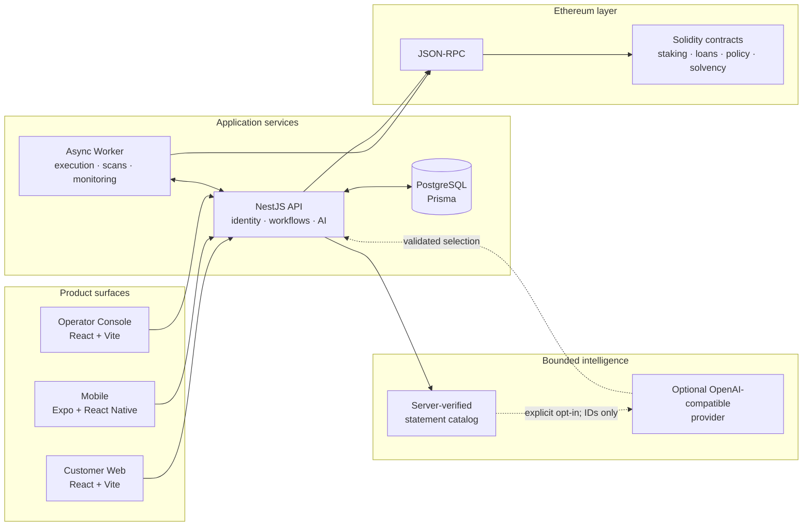

<div align="center">

# Stealth Trails AI Bank

### AI-native Ethereum fintech infrastructure, built for governed money movement and trustworthy wealth intelligence.

[](https://github.com/waqasraza123/stealth-trails-ai-bank/actions/workflows/monorepo-ci.yml)
[](https://www.typescriptlang.org/)
[](https://nestjs.com/)
[](https://react.dev/)
[](https://ethereum.org/)
[](https://hardhat.org/)
[](LICENSE)

[Explore the architecture](#architecture) · [See what is implemented](#capabilities) · [Run locally](#local-development) · [View the roadmap](#roadmap)

</div>

---

## Overview

Stealth Trails AI Bank is a full-stack engineering portfolio for an Ethereum-connected fintech SaaS. It combines customer web and mobile experiences, a governed banking API, smart contracts, asynchronous chain execution, internal operations tooling, and a privacy-conscious AI wealth intelligence workflow.

This repository demonstrates how AI can sit beside financial infrastructure without bypassing its controls. The implemented AI surface is read-only, bounded by server-verified facts, explicit about data sharing, and unable to approve or execute financial activity.

> [!IMPORTANT]
> This is an engineering project, not a licensed bank, broker, financial adviser, or investment service. Nothing in the application or this repository is financial or investment advice.

### Financial Research Agent and independent evaluation

Copilot now also exposes an opt-in, non-production **Financial Research Agent** at `POST /ai/copilot/research`. A bounded LangGraph loop lets a configured LLM select typed read-only tools, observe real service results, and answer with evidence. Customer identity, ownership, consent, permissions and budgets are enforced by the backend. Financial calculations and transaction approvals remain authoritative deterministic services.

The [isolated SafeLabs integration](evaluations/safelabs/README.md) provides a separately authenticated local evaluation API, two persisted synthetic customer fixtures, a restricted PostgreSQL role, an internal Docker network with a fixed model gateway, pinned original ASI06 prompts, independent tool traces, and JSON/Markdown reports. Mock-model verification is separate from live evaluation. No live 30-prompt security result is claimed without a configured real provider and an explicitly authorized API budget.

## Why this project stands out

- **Real financial workflow boundaries** — ledger-backed balances, intent-based deposits and withdrawals, settlement tracking, reconciliation, and audit events.
- **Governance before execution** — review queues, account restrictions, policy-controlled withdrawals, treasury controls, and release-readiness approvals.
- **AI with constrained authority** — an opt-in Wealth Brief can prioritize only server-generated, evidence-linked statements; it cannot invent amounts, change severity, or move funds.
- **Ethereum-native infrastructure** — ethers.js integrations, managed execution workers, Solidity contracts, deployment manifests, and solvency report anchoring.
- **Portfolio-grade product surfaces** — responsive customer web, Expo mobile, an operator console, bilingual English/Arabic interfaces, and end-to-end tests.
- **Operational depth** — health checks, metrics, notifications, alert routing, reconciliation scans, incident packages, rollback evidence, and scheduled worker jobs.

## Product preview

### Customer web

| English dashboard | Arabic dashboard |
| --- | --- |
|  |  |

### Mobile banking

<p align="center">
  
  
  
  
</p>

## Capabilities

### Implemented banking and fintech capabilities

| Area | What exists in the codebase |
| --- | --- |
| Accounts and identity | Customer authentication, account lifecycle, managed wallet ownership, profile projection, MFA workflows, session trust, and account restrictions |
| Money movement | Deposit and withdrawal intents, operator review, execution state, settlement evidence, replay controls, and email-to-email internal transfers |
| Ledger and balances | Supported assets, double-entry ledger models, balance projections, transaction history, reconciliation scans, and repair tooling |
| Lending | Quote previews, loan applications, agreements, collateral and valuation tracking, installments, autopay, default escalation, and liquidation review workflows |
| Wealth products | Governed staking/yield operations and retirement vaults with release rules, strict mode, and protected balances |
| Solvency | Snapshots, reserve evidence, liability inclusion proofs, public reports, policy actions, and on-chain report-hash anchoring |
| Operations | Review cases, oversight incidents, audit trails, notifications, alerts, treasury visibility, governed exports, and release approvals |
| Client experiences | React web app, Expo/React Native mobile app, internal React admin console, English/Arabic localization, and accessibility-aware UI primitives |

### Implemented AI: Wealth Brief

The current AI feature is a customer-facing, read-only Wealth Brief available in the web application and through authenticated NestJS endpoints.

It is deliberately narrow:

1. The API assembles a bounded snapshot from balances, transactions, staking positions, outstanding loans, retirement vaults, and solvency evidence.
2. The server creates a catalog of deterministic observations, risk flags, severities, source references, and research questions.
3. Without an external provider, the feature returns a clearly labeled deterministic preview.
4. When an OpenAI-compatible provider is configured **and the customer opts in for that request**, the model may only select and rank catalog IDs.
5. Unknown IDs, fabricated references, malformed output, or provider failures trigger a deterministic fallback.

The provider receives no raw balances, amounts, names, emails, wallet addresses, account IDs, credentials, or signing material. Requests are authenticated and rate-limited. The result includes source status, timestamps, provider disclosure, generation mode, fallback reason, and a non-advice disclaimer.

> [!NOTE]
> AI agents, autonomous portfolio management, trade execution, personalized investment recommendations, and external ethical-investment research are **not implemented**. They are roadmap items and will remain human-governed if introduced.

## Architecture



The API owns customer identity, workflow state, ledger-facing operations, and policy decisions. Workers perform approved asynchronous execution and monitoring. Sensitive actions remain explicit, auditable state transitions instead of model-directed side effects.

## Technology stack

| Layer | Technologies |
| --- | --- |
| Monorepo | pnpm workspaces, Turborepo, TypeScript |
| Customer web | React 18, Vite, React Router, TanStack Query, Tailwind CSS, Radix UI, Zustand |
| Mobile | Expo 55, React Native, React Navigation, TanStack Query, Secure Store |
| Admin | React 18, Vite, TanStack Query |
| API | NestJS 10, Prisma 6, PostgreSQL, class-validator, Passport JWT, WebSockets |
| AI | Provider-optional OpenAI-compatible chat-completions adapter, schema validation, deterministic fallback |
| Ethereum | ethers.js, Solidity, Hardhat, OpenZeppelin, TypeChain, Ignition |
| Quality | Jest, Vitest, Playwright, Testing Library, GitHub Actions |
| Operations | Structured logging, health and metrics endpoints, scheduled workers, alerting, reconciliation, release evidence |

## Repository map

```text
stealth-trails-ai-bank/
├── apps/
│   ├── api/           # NestJS domain API, persistence, workflows, and Wealth Brief
│   ├── web/           # Customer React application
│   ├── mobile/        # Expo / React Native customer application
│   ├── admin/         # Internal operator console
│   └── worker/        # Async execution, chain monitoring, and scheduled controls
├── packages/
│   ├── contracts/     # Solidity contracts, tests, and deployment manifests
│   ├── contracts-sdk/ # Shared ABIs and Ethereum integration helpers
│   ├── config/        # Typed runtime configuration
│   ├── db/            # Shared Prisma client boundary
│   ├── i18n/          # Localization infrastructure
│   ├── security/      # Shared security helpers
│   ├── types/         # Cross-application contracts
│   └── ui-foundation/ # Shared design tokens and interaction primitives
├── tests/e2e/         # Playwright customer and operator journeys
└── docs/              # Architecture decisions, runbooks, roadmaps, and release plans
```

## Local development

### Prerequisites

- Node.js 20+
- pnpm 9.15.0
- PostgreSQL
- An Ethereum JSON-RPC endpoint for chain-connected flows

### 1. Clone and install

```bash
git clone https://github.com/waqasraza123/stealth-trails-ai-bank.git
cd stealth-trails-ai-bank
pnpm install
```

### 2. Configure environment files

Use the checked-in `.env.example` files for each application. The API requires values for its database, authentication, chain, and internal-service boundaries. Core variables include:

```dotenv
DATABASE_URL=
DIRECT_URL=
JWT_SECRET=
JWT_EXPIRY_SECONDS=
PRODUCT_CHAIN_ID=
INTERNAL_OPERATOR_API_KEY=
INTERNAL_WORKER_API_KEY=
RPC_URL=
ETHEREUM_PRIVATE_KEY=
```

For contract-connected staking flows, configure `STAKING_CONTRACT_ADDRESS`. Never use a production-funded private key in local development.

The mobile app reads `EXPO_PUBLIC_API_BASE_URL` from `apps/mobile/.env`.

### 3. Prepare the database

```bash
pnpm --filter @stealth-trails-bank/api prisma:generate
pnpm --filter @stealth-trails-bank/api prisma:migrate
```

### 4. Start the workspace

```bash
pnpm dev
```

The repository preflight checks local API/worker wiring and Prisma migration state before startup. To start mobile development separately:

```bash
pnpm dev:mobile
```

### Optional external AI provider

External model use is disabled by default. The deterministic Wealth Brief works without it. To enable the opt-in provider path, configure the AI wealth-brief runtime variables, including an HTTPS endpoint, an explicit hostname allow-list, API key, and model. See `packages/config/src/node-runtime-config.ts` and the API environment example for the complete validated configuration.

Production external AI remains disabled and must not be enabled until DNS/IP-level outbound security controls are implemented and verified.

## Validation commands

| Command | Purpose |
| --- | --- |
| `pnpm build` | Build all workspace packages with build scripts |
| `pnpm lint` | Run configured workspace lint tasks |
| `pnpm test:unit` | Run API, worker, web, and admin unit tests |
| `pnpm test:integration` | Run API integration and Solidity contract tests |
| `pnpm test:e2e` | Run Playwright customer and operator journeys |
| `pnpm test:coverage` | Run workspace coverage gates |
| `pnpm mobile:verify` | Type-check, test, and export the mobile app |
| `pnpm api:smoke:local` | Exercise the compiled API handler, health endpoints, and CORS |
| `pnpm verify:push` | Run the repository's mandatory local push gate |

## Security and trust model

- Financial mutations use explicit workflow states and policy checks.
- Operator and worker interfaces have separate internal authentication boundaries.
- High-risk actions produce durable audit evidence and support recovery workflows.
- External AI use is disabled by default, request-scoped, disclosed, minimized, validated, and read-only.
- Smart-contract deployments are represented by validated manifests.
- Solvency evidence and report anchoring are modeled independently from customer-facing claims.
- Secrets, real private keys, and production credentials must never be committed.

Read [SECURITY.md](SECURITY.md) before reporting vulnerabilities or working with sensitive configuration.

## Roadmap

Roadmap items are directional and **not claims of current functionality**.

### Near term

- [ ] Complete staged release-readiness drills and governed launch evidence
- [ ] Expand Wealth Brief end-to-end coverage across degraded-source and provider-failure paths
- [ ] Add mobile parity for the read-only Wealth Brief
- [ ] Publish stronger demo data and portfolio walkthroughs without exposing real customer information

### Planned AI engineering

- [ ] Evidence-cited ethical investment research workspace with source freshness and conflict checks
- [ ] Human-approved operations agents for reconciliation triage, incident summaries, and runbook suggestions
- [ ] Policy-bound financial scenario modeling that cannot execute transactions or alter account state
- [ ] Evaluation suites for groundedness, prompt-injection resistance, privacy leakage, and financial-safety regressions
- [ ] Provider abstraction with cost, latency, availability, and data-residency controls

### Platform evolution

- [ ] Future enhancement: customer web passkey setup prompts and passwordless login on Mac and other supported devices, with password/MFA fallback
- [ ] Broaden contract deployment proofs and public verification tooling
- [ ] Deepen disaster-recovery, rollback, and notification-delivery evidence
- [ ] Continue accessibility, localization, and cross-platform experience parity

Detailed plans and status live under [`docs/`](docs/), including architecture decisions, production roadmaps, mobile plans, and operational runbooks.

## Contributing

Contributions should preserve explicit state transitions, durable auditability, recovery-safe behavior, and human control over money-critical actions. Start with [CONTRIBUTING.md](CONTRIBUTING.md), [CODE_OF_CONDUCT.md](CODE_OF_CONDUCT.md), and [SECURITY.md](SECURITY.md).

## License

Distributed under the [MIT License](LICENSE).

---

<div align="center">

**Stealth Trails AI Bank** — governed Ethereum fintech infrastructure with AI that stays inside the lines.

</div>
